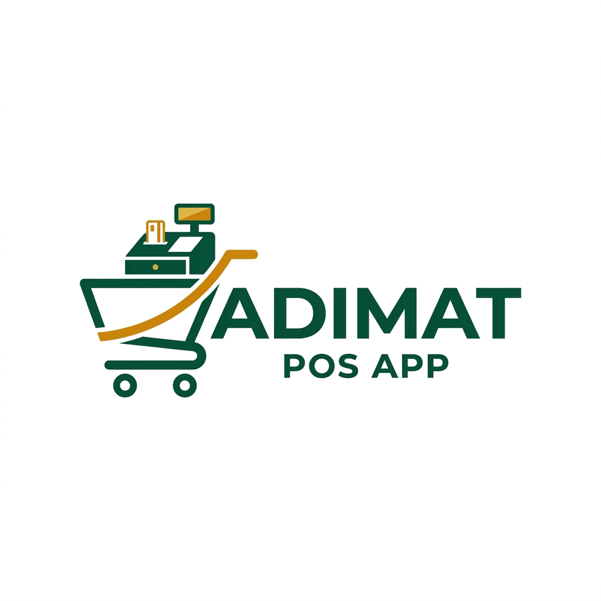

# Adimat POS

A mobile-first Point of Sale (POS) and inventory management Progressive Web App (PWA) designed for SMEs in Ghana.

**Full system documentation:** see [`SYSTEM_DOCUMENTATION.md`](./SYSTEM_DOCUMENTATION.md) for architecture, data models, sync, security, integrations, and operations.

**Learn Adimat:** The signed-in app shows owner or cashier lessons for that user's role, with screen illustrations and a matching downloadable PDF. Platform administrators have a separate **Learn** area inside the authenticated administrator portal, including its own technical guide. The [store owner guide PDF](./public/guides/adimat-store-owner-guide.pdf), [cashier guide PDF](./public/guides/adimat-cashier-guide.pdf), [administrator and technical guide PDF](./public/guides/adimat-admin-technical-guide.pdf), and [technical system documentation](./SYSTEM_DOCUMENTATION.md) are also available in the repository.



## Features

### 🛒 Point of Sale
- **Barcode Scanning** — Camera-based scanning using ZXing library with back camera preference
- **Manual Entry** — Search products by name or enter barcodes manually
- **Real-time Cart** — Add, remove, and adjust quantities with instant totals
- **Stock Validation** — Prevents selling out-of-stock items, warns on low stock
- **Flexible Payments** — Cash, Paystack, split payments, offline-recorded MTN/Telecel/AirtelTigo MoMo, bank transfers, card-terminal payments, and customer credit with outstanding-balance tracking
- **Hold Sale** — Park a cart while serving another customer, then resume it in the same POS session
- **Discount Management** — Apply discounts with optional owner PIN authorization for amounts exceeding the configured cap
- **PDF Receipts** — Generate, download, and share receipts as PDF files

### 📦 Inventory Management
- **Product Catalog** — Full product CRUD, plus owner-managed category create, rename, and delete
- **Optional Product Photos** — Add a picture when creating/editing a product; shown in inventory and at checkout
- **Stock Tracking** — Automatic stock deduction on sales, low stock and out-of-stock alerts
- **Stock Adjustment** — Manually add, remove, or set stock levels with reason tracking
- **Restock Alerts** — Configure a reorder level per product and review suggested restock quantities
- **Stock Audit Trail** — Review and export recorded receipts, transfers, sales, and adjustments with staff and location details
- **Barcode Assignment** — Scan barcodes directly when adding products
- **Profit Margin Calculator** — Auto-calculates margin based on cost and selling price
- **Dashboard Cards** — Total SKUs, out of stock count, low stock count, total inventory value
- **Auto-Refresh** — Inventory updates automatically every 30 seconds

### 📊 Reports & Analytics
- **Period Filtering** — Today, This Week, This Month views
- **Revenue Breakdown** — Cash vs non-cash collections; manual payments are kept separate from Paystack payout totals
- **Credit Sales** — Save customer details, track outstanding balances, and record cash repayments from Sales history
- **7-Day Rolling Chart** — Visual revenue trend using bar charts
- **Transaction Register** — Chronological audit log with expandable item details

### 📒 Cash Book
- **Cash and Bank Accounts** — Record each income or expense against Cash or Bank and review each account’s net volume

### 👥 Customers Book
- **Registered Customers** — Store customer names and phone numbers and review their credit sales and account balances
- **Starting Balances** — Enter existing customer debt when registering a customer; repayments are recorded against that opening balance
- **Credit Checkout** — Credit sales require selecting an active registered customer and add the sale to their outstanding balance
- **Customer Records** — Edit customer details or archive/reactivate a customer; customers with outstanding debt cannot be archived

### ⚙️ Settings
- **Store Profile** — Configure store name, address, and support number
- **Discount Controls** — Set discount cap percentage and toggle PIN enforcement
- **User Management** — Add/remove cashiers and owners with 4-digit PINs
- **Automatic Session Timeout** — Owners set how long the till may sit idle (off, or 1–30 minutes; default 5). Staff are returned to the PIN screen, the cart is cleared, and a refresh cannot restore a stale session.
- **Receipt Printing** — Print directly to a connected Bluetooth thermal printer, or choose a computer printer from the browser print dialog
- **Cloud Sync** — Manual sync to Supabase with last-synced timestamp. Owners use **Settings**; cashiers use **My Sales** or **Devices → Cloud Sync** (Full Sync / Pull / Push) so they can send sales and pick up stock updates.
- **Backup & Sync Health** — Daily on-device snapshots, downloadable store backups, restore, pending-change count, and last sync/backup errors

### 📈 Owner dashboard & product search
- **Owner Home** — Today’s sales, cash and non-cash totals, low-stock count, and one-tap new sale/product/expense actions; cashiers continue directly to POS
- **Smarter POS Search** — Typo-tolerant product-name search, partial barcode matching, recently and frequently sold products prioritized, and optional voice input where the browser supports it

### 💸 Expense controls
- **Recurring Expenses** — Schedule monthly costs such as rent and salaries, which are recorded automatically on or after the chosen day
- **Receipt Photos** — Attach a compressed photo of an expense receipt
- **Monthly Budgets** — Set category limits and see an over-budget warning as spending passes the limit

### 📱 PWA & Offline Support
- **Installable** — Add to home screen on mobile devices
- **Offline-First** — All data stored locally in IndexedDB via Dexie.js
- **Background Sync** — Sync to Supabase when online
- **Mobile Optimized** — Touch-friendly targets, bottom navigation, portrait orientation

## Tech Stack

| Layer | Technology |
|-------|------------|
| Framework | React 19 + TypeScript + Vite |
| Styling | Tailwind CSS v4 |
| State | Zustand |
| Local Database | Dexie.js (IndexedDB) |
| Backend | Supabase (PostgreSQL + Auth) |
| Payments | Paystack |
| Charts | Recharts |
| Barcode Scanning | BarcodeDetector API |
| Printing | Web Bluetooth API (ESC/POS) |

## Getting Started

### Prerequisites

- Node.js 18+
- npm or yarn

### Installation

```bash
# Clone the repository
git clone <repository-url>
cd adimat-pos

# Install dependencies
npm install

# Start development server
npm run dev
```

### Environment Variables

Create a `.env` file in the root directory:

```env
# Supabase Configuration
VITE_SUPABASE_URL=https://your-project.supabase.co
VITE_SUPABASE_ANON_KEY=your-anon-key

# Paystack Configuration
VITE_PAYSTACK_PUBLIC_KEY=pk_live_your-public-key

# Optional mNotify defaults for non-admin SMS alerts
# VITE_MNOTIFY_API_KEY=
# VITE_MNOTIFY_SENDER_ID=Adimat
```

> **Note:** The app works fully offline without Supabase configured. Cloud sync and the **Administrator portal** require Supabase credentials.

### Administrator Portal

Platform admins sign in with the administrator PIN only; admin login does not send SMS or use Supabase Auth. The app reads the existing `VITE_ADMIN_PIN` from the Vercel server function at `/api/manage-promotional-campaigns`; the PIN is not checked in browser code.

Campaign management uses that PIN-only session through the Vercel API route. Apply `supabase-migrate-promotional-campaigns.sql`, then make sure the Vercel project has these environment variables:

- `VITE_ADMIN_PIN` — the admin PIN already configured in Vercel.
- `VITE_SUPABASE_URL` — the existing Supabase project URL.
- `SUPABASE_SERVICE_ROLE_KEY` — the Supabase service-role key as a private Vercel environment variable (not prefixed with `VITE_`).

The API function uses Supabase service credentials server-side to write campaigns. Do not expose the service-role key to browser code or open campaign write policies to `anon`. Vercel automatically deploys the API route with the app.

Published campaigns appear on the store login screen for all store users. Campaign details and media are cached on each device after that device loads them while online, so they can be shown offline later. A device must load the campaigns at least once while online; campaign changes made elsewhere appear after it reconnects.

The portal loads cloud data and shows:

- All stores, users, and products
- Subscription grants and usage
- **Create a store** — Admin → Stores creates the shop, owner PIN, and **downloads a subscription invoice PDF immediately** (Aktum / Adimat bill matching the official invoice). Share the Store ID so the owner can open it on their phone.
- **Contact** settings: WhatsApp number + email shown on every store’s **Plan** tab, and mNotify SMS API key/sender ID for store alerts
- All-time revenue and Paystack (online) totals per store
- Weekly Paystack collections with each store’s MoMo account name/number for remittance
- **Mark sent** to record that a weekly payout was transferred
- **Clear trial sales** — from a store’s workspace, wipe that store’s sales, expenses, cash book, and remittance records so Transactions and Reports start empty after testing. Products, staff, and stock stay. The store must **sync** afterwards. Requires `supabase-migrate-clear-store-ledger.sql` if your project predates this feature.

Store owners and cashiers open **Plan** to view subscription status and contact the administrator (WhatsApp / email loaded from Admin → Contact). SMS alerts via mNotify notify the store’s Support Phone when a subscription is activated and once when it is within 7 days of expiry.

### Warehouse, bulk & expiry

Platform admins can enable warehouse features per store and set **max shops** / **max warehouses**. When enabled, owners get a **Warehouse** tab that works as a **separate location workspace** (not mixed into POS):

1. Open **Warehouse** → choose a shop or warehouse location  
2. Manage that location only: **Stock**, **Receive**, **Transfer** (in/out), **Expiry**, **Adjust**, **History**, and **Report**  
3. Export individual shop/warehouse reports (CSV/PDF) from Warehouse or **Reports → Locations**

Reports overview includes a donut chart for **Cost price** (blue), **Selling price** (green), and **Profit Estimate** (yellow = selling − cost), with Selling price shown in the center.

Products support pack size, expiry tracking, and owner-defined wholesale pricing (`pack`, lower unit price, or quantity tiers). POS sells **retail or wholesale** from the cashier’s location (warehouse sales only if permitted). Stock deducts with **FEFO** when batches have expiry dates.

If your Supabase project predates this feature, run `supabase-migrate-warehouse.sql` in the SQL Editor.
For store quotas + warehouse PINs, run `supabase-migrate-store-quotas.sql` (includes `max_stores` and the canonical `store_quotas` table).

### Supplier purchasing and restocking

Owners can open **Purchasing** to save supplier contact details, create purchase orders, receive orders in full or in partial quantities into a selected shop/warehouse, and cancel open orders. Receiving adds stock batches and stock-movement audit entries, and updates product cost prices. Set a product’s **Restock alert quantity** from its Inventory edit form; **Inventory → Restock & audit** shows items at or below that level and a suggested quantity.

If your Supabase project predates these tables/columns, run `supabase-migrate-purchasing-reorder.sql` in the SQL Editor before syncing purchasing or reorder-level data. New projects receive the schema from `supabase-init.sql`.

### Backups and sync health

Owners can open **Settings → Backup & sync health** to download a JSON backup, restore a backup for the currently selected store, inspect pending local changes and recent sync/backup errors, and download the latest automatic snapshot. Authenticated sessions also create one daily snapshot in the browser, retaining up to seven. Browser snapshots are not off-device protection: download backups to a separate secure location. Backup files include sensitive store and staff data, including PIN hashes, and are limited to 50 MB. Restoring replaces that store’s local data on the current device; unsynced rows in a restored backup may be uploaded during the next cloud sync.

### E-commerce storefront

Platform admins can enable a public online shop per store (Admin → Subscriptions → **E-commerce storefront**) and set a slug used in `#/shop/{slug}`.

1. Admin enables e-commerce and saves a slug  
2. Store owner syncs, then opens **Online** to copy the share link and list products  
3. Opt products in via Inventory → product → **Sell online**, or from the Online catalog tab  
4. Customers browse the public link and place **pay on delivery** orders  
5. Owner (or cashiers with **Can manage online shop**) fulfill orders from the Online inbox  

If your Supabase project predates this feature, run `supabase-migrate-ecommerce.sql` in the SQL Editor.

Cashier Cash Book access is toggled by the owner in **Settings → Staff → Perms**. New cashiers start with Cash Book **off**. Existing cashiers keep access until the owner turns it off. If your project predates this column, run `supabase-migrate-cashier-cashbook.sql`.

Store owners set their preferred MoMo account under **Settings → Mobile Money Payout**, then sync to Supabase.

If your Supabase project was created before these features, run `supabase-migrate-admin.sql`, `supabase-migrate-subscriptions.sql`, `supabase-migrate-platform-settings.sql`, `supabase-migrate-clear-store-ledger.sql`, and `supabase-migrate-cashier-cashbook.sql` in the SQL Editor (or re-apply the latest `supabase-init.sql`).
For self-serve Paystack subscription renewals, also run `supabase-migrate-subscription-payments.sql`.
For automatic session timeout (idle PIN lock), run `supabase-migrate-session-timeout.sql`.
For manually recorded MoMo, bank transfer, and card-terminal sales, run `supabase-migrate-manual-payments.sql`.
For credit sales, owner-managed product categories, and Cash/Bank cash-book entries, run `supabase-migrate-credit-sales-bank-categories.sql` before syncing.
For the Customers book and registered-customer credit checkout, run `supabase-migrate-customers-book.sql` after the credit-sales migration and before syncing. It also links existing credit sales to registered customer records.
For automated debt reminders, the live owner dashboard and the multi-store consolidated view, run `supabase-migrate-debt-reminders-dashboard.sql`. It adds the reminder rules and sales targets to `stores`, the per-customer opt-out to `customers`, the `debt_reminders` audit table, and publishes `transactions` to the realtime channel so the dashboard live feed works.
For owner bulk SMS campaigns, run `supabase-migrate-bulk-sms.sql`. If you already ran it, run `supabase-migrate-bulk-sms-device-writes.sql` as well — it lets the device save its own campaign log, which is what stops the sync failing with "new row violates row-level security policy for table bulk_sms_campaigns".

### Multi-store on one device

Store owners can keep **multiple stores** on the same phone/tablet:

1. **Settings → My Stores** — create another store or open one from cloud (Store ID + owner PIN) without wiping existing stores  
2. **Login store picker** — when more than one store is on the device, choose which store to open, then enter that store’s PIN  
3. After opening a store, **Inventory** and **Settings → Staff** apply only to that store  

Platform admins can also **Admin → Stores → tap a store** to view that store’s inventory, download an invoice PDF, and manage its staff in the portal.

### Branch inventory transfer (owner)

Stock can be moved between any stores linked to the same owner account. The feature lives on the **Branch inventory** tab (and stays available from **Settings → My Stores**):

1. Pick the **From store** and the **To store**.
2. Tick the products to move and type the **quantity to transfer** for each one. Several products can be moved to the same destination in one go.
3. Items that already exist at the destination are **merged** into that stock. Items the destination does not stock yet are listed first, and the transfer only continues once the owner chooses **Create and transfer**.
4. Press **Transfer N item(s)**. The source stock is deducted, the matching quantity is added at the destination, and both are recorded in the **Transfer history** table, showing the product, the quantity, the date and the route from one store to the other.

### Owner dashboard, debt reminders and all-stores view

Owners get three new tools:

1. **Home (owner dashboard)** — a live view of today’s sales, cash vs non-cash, average basket, customer credit owed, low-stock count and the latest sales as they happen. The badge shows **Live** when the realtime feed is connected and **Offline** when the device falls back to its regular refresh. Set a daily or monthly sales target under **Settings → Sales targets** to see a progress bar.
2. **Automated debt reminders** — under **Settings → Debt reminders**, turn on the automatic chase, pick how often a customer is reminded (1–30 days), set a minimum balance, and edit the message. Use `{name}`, `{store}` and `{balance}` in the text. Customers can be excluded from the chase with the **Reminders on/off** button on their row in the Customers book. Every attempt is recorded so the owner can see who was chased and when. Owners can also press **Send reminders now** on the Customers screen to chase a balance immediately.
3. **All stores (consolidated view)** — when the device has more than one store, the nav shows **All stores**: combined today/month sales, cash, profit after costs, customer credit and low stock, with a card per store, one-tap store switching and a CSV export.

### First launch (phones & tablets)

Stores are **created by the administrator**, not from the first screen. On a new phone or tablet:

1. Open Adimat
2. Enter the **Store ID** and **owner PIN** your administrator gave you
3. Tap **Open store**, then sign in with that PIN

Administrators: open **Administrator portal** on the first screen → **Stores → Create a store**. An invoice PDF downloads as soon as the store is created.

Each store has its own isolated data — products, users, and transactions are all scoped to your store.

### Setting Up Your Store

1. Login with the owner PIN your administrator set for the store
2. Go to **Settings** (store name, address, and phone remain required)
3. Configure discount controls
4. Add staff members with their own PINs. Under **Perms**, turn **Can open cash book** on or off for each cashier.
5. Optionally set up biometric login
6. Connect a Bluetooth thermal printer under **Devices** / **More**
7. Go to **Inventory** and add your products

## Database Setup (Supabase)

1. Create a new Supabase project
2. Navigate to the SQL Editor
3. Run the contents of `supabase-init.sql` to create all tables with RLS policies

### Database Schema

| Table | Description |
|-------|-------------|
| `stores` | Business/store profiles with settings |
| `users` | Store staff linked to a store, with roles and PIN hashes |
| `products` | Product catalog linked to a store |
| `transactions` | Completed sales linked to a store |
| `transaction_items` | Line items for each transaction |

**Multi-tenant Architecture:** All data is scoped to a specific store via `store_id` foreign keys. This ensures complete data isolation between different businesses using the app.

## Building for Production

```bash
# Build the application
npm run build

# Preview the production build
npm run preview
```

The build output is a single `index.html` file in the `dist/` directory, optimized for deployment.

## Deployment

### Vercel (Recommended)

1. Connect your repository to Vercel
2. Add environment variables in the Vercel dashboard
3. Deploy

### Static Hosting

The built `dist/index.html` can be deployed to any static hosting service:

- Netlify
- GitHub Pages
- Cloudflare Pages
- AWS S3 + CloudFront

## Hardware Integration

### Bluetooth Hardware (Settings)

Go to **Settings → Bluetooth Hardware** to discover and pair peripherals in-app:

| Device | How it works |
|--------|----------------|
| **Thermal printer** | Web Bluetooth pairing to ESC/POS BLE printers; receipts via `printService` |
| **BLE barcode scanner** | Optional GATT pairing (Nordic UART / notify characteristics) |
| **HID handheld scanner** | Pair in system Bluetooth settings, then enable **HID Scanner Input** (default on). Scans feed POS checkout and inventory stock logging |

Saved pairings can be reconnected from Settings. The app also attempts silent reconnect on launch when the browser permits it.

### Camera Barcode Scanner

The app also uses `@zxing/library` for on-device camera scanning. Supported formats:
- EAN-13, EAN-8
- UPC-A, UPC-E
- Code 128, Code 39, Code 93
- QR Code, Data Matrix, Aztec
- ITF, Codabar, RSS-14

**Tips for reliable camera scanning:**
- Ensure good lighting
- Hold the barcode steady within the scanning frame
- Keep the barcode flat and not crumpled
- The back camera is automatically selected when available

### Thermal Printer (ESC/POS)

`src/lib/printService.ts` formats receipts with the Adimat logo and services contact for connected Bluetooth printers. When no Bluetooth printer is connected, checkout and receipt reprints open the computer's native print dialog to select a printer.

For unattended printing on a dedicated Windows computer, first set the desired printer as the Windows default, then launch Chrome with `--kiosk-printing --app="https://YOUR-ADIMAT-URL"`. Chrome sends print jobs to the default printer without showing the chooser. Ordinary browser tabs continue to show the print dialog; browsers may remember the last printer and settings, but the web app cannot force or persist them. Android Chrome requires its system print UI for web pages; silent printing there requires a managed kiosk/native printing solution.

The standard app does not configure kiosk mode automatically. Test the printer's paper size and other defaults from Windows printer settings before using unattended printing. Tested with:
- Generic 58mm Bluetooth thermal printers
- Most printers using the `000018f0-0000-1000-8000-00805f9b34fb` service UUID

To connect:
1. Go to Settings → Bluetooth Hardware
2. Tap **Pair Bluetooth Printer**
3. Select your printer from the system picker
4. Optionally run **Test Print**

## Project Structure

```
src/
├── components/          # Reusable UI components
│   ├── AddProduct.tsx
│   ├── BarcodeScanner.tsx
│   ├── BottomNav.tsx
│   ├── CheckoutOverlay.tsx
│   └── PWAInstallBanner.tsx
├── components/
│   ├── BluetoothHardwareSettings.tsx  # Pair printer + scanner
│   └── …
├── hooks/
│   └── useBluetoothBarcodeInput.ts    # Handheld scanner capture
├── lib/
│   ├── bluetoothPeripherals.ts        # Discover / pair / reconnect
│   ├── barcodeScannerInput.ts         # HID + BLE scan fan-out
│   ├── printService.ts                # ESC/POS receipt formatting
│   ├── bluetoothPrinter.ts            # Compatibility façade
│   ├── dexie.ts
│   ├── paystack.ts
│   └── supabase.ts
├── pages/               # POS, Inventory, Reports, Settings, …
├── store/               # Zustand auth + cart
├── App.tsx
├── main.tsx
└── index.css
```

## Receipt Format

Receipts are generated with the format `#ADM-YYYYMMDD-XXXX`:
- `ADM` — Adimat prefix
- `YYYYMMDD` — Date
- `XXXX` — 4-digit sequential number

Example: `#ADM-20240115-0042`

## Security

- PINs are hashed before storage (not plain text)
- Row Level Security (RLS) enabled on all Supabase tables
- Discount overrides require owner PIN verification
- Role-based access control (cashiers vs owners). Owners can allow or deny each cashier **Cash Book** access.

## Browser Support

- Chrome 83+ (Desktop & Android)
- Edge 83+
- Safari 14.1+ (iOS & macOS)
- Firefox (limited — no Web Bluetooth)

## iOS Installation

To install on iPhone or iPad:

1. Open the app in **Safari** (required - other browsers don't support PWA installation)
2. Tap the **Share** button (square with arrow at bottom of screen)
3. Scroll down and tap **"Add to Home Screen"**
4. Tap **"Add"** in the top right corner
5. Adimat will now appear as an app on your home screen

**Note:** The app will show an install banner with step-by-step instructions when opened in Safari on iOS.

### iOS-Specific Features

- Full-screen standalone mode (no Safari UI)
- Home screen icon
- Splash screen on launch
- Works offline after first load
- Safe area support for notched devices (iPhone X and later)

## License

MIT License — see LICENSE file for details.

  ## Support

For issues and feature requests, please open a GitHub issue.

---

**Built with ❤️ for Ghana SMEs**
